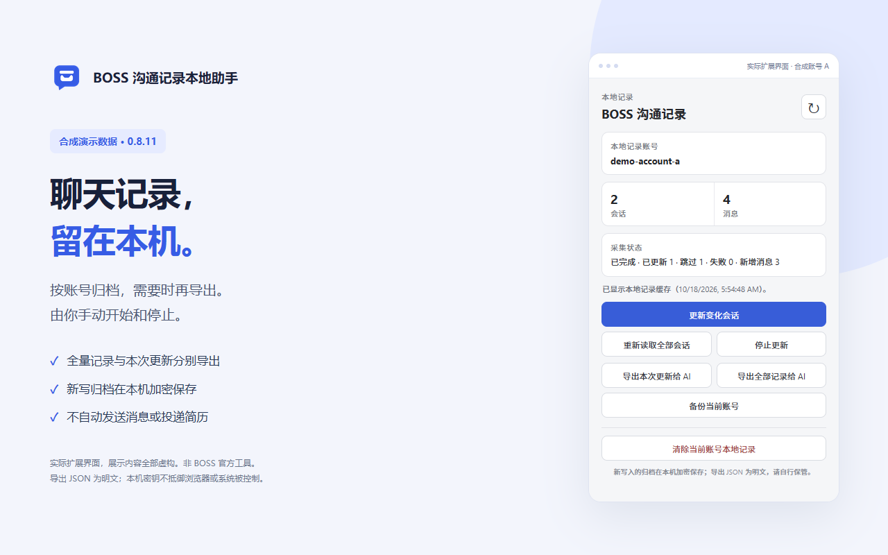

# BOSS Chat Recorder

[English](README.md) | [简体中文](README_CN.md)

An independently developed browser extension, published on the Chrome Web Store, for archiving your BOSS conversations on your device.

[Install from Chrome Web Store](https://chromewebstore.google.com/detail/phaihpchfdihnclgjhpmpnhobdcogdhb) · [Source code](https://github.com/L1pp/boss-chat-recorder) · [Architecture](docs/ARCHITECTURE.md)

*The screenshot uses synthetic demo data.*

## Highlights

- Built as a Manifest V3 extension with Simplified Chinese and English interfaces.
- Collects and incrementally updates conversation archives, with resume after interruption.
- Isolates local archives by account and encrypts newly stored records on device.
- Exports JSON for personal organization and analysis.

[Usage guide](docs/USAGE.md) · [Privacy policy](extension-tracker/PRIVACY.md) · [MIT License](LICENSE) · [Issues](https://github.com/L1pp/boss-chat-recorder/issues)

This independently developed project is not affiliated with or endorsed by BOSS Zhipin.
