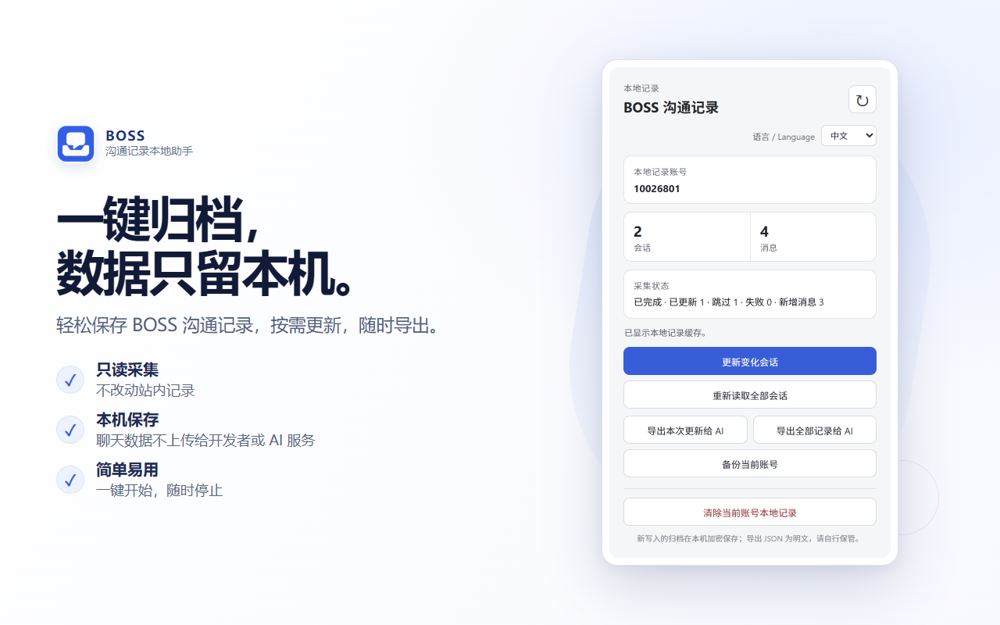
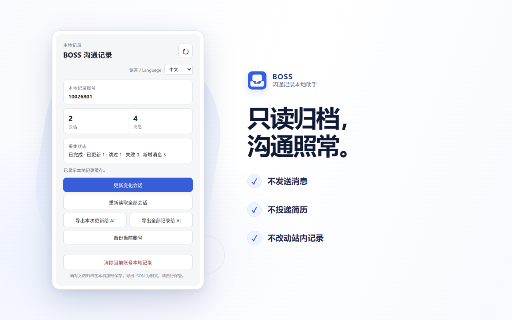
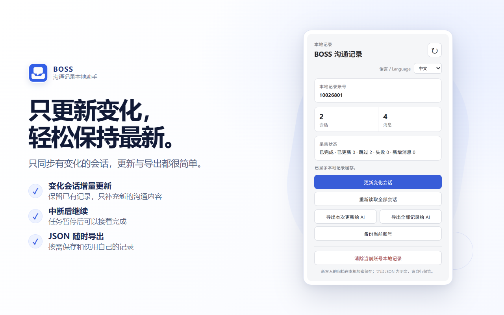
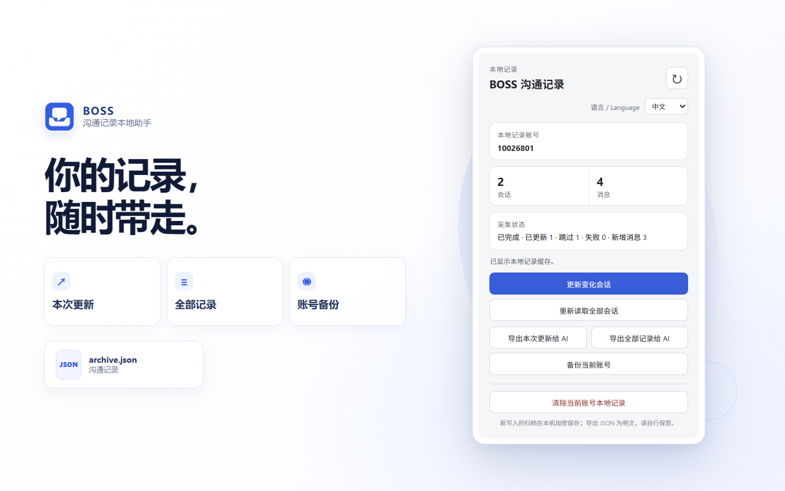
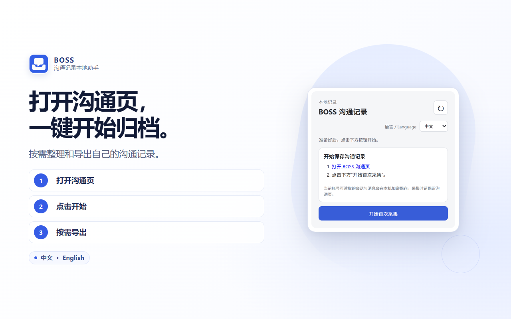

# BOSS 沟通记录本地助手

[English](README.md) | [简体中文](README_CN.md)

自主开发并上架 Chrome Web Store 的浏览器扩展，用于在本机归档个人 BOSS 沟通记录。

[Chrome 商店安装](https://chromewebstore.google.com/detail/phaihpchfdihnclgjhpmpnhobdcogdhb) · [源码](https://github.com/L1pp/boss-chat-recorder) · [架构说明](docs/zh-CN/ARCHITECTURE.md)

## 核心成果

- 基于 Manifest V3 构建，提供简体中文和英文界面。
- 增量采集与更新沟通记录，支持中断后继续。
- 按账号隔离本地归档，新写入的数据在本机加密。
- 导出 JSON，供个人整理和分析。

更多界面与功能展示

[使用指南](docs/zh-CN/USAGE.md) · [隐私说明](extension-tracker/PRIVACY.md) · [MIT License](LICENSE) · [问题反馈](https://github.com/L1pp/boss-chat-recorder/issues)

本项目独立开发，与 BOSS 直聘无隶属、授权或背书关系。
